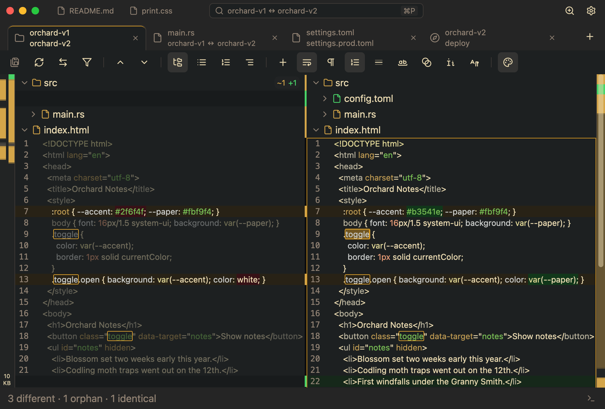
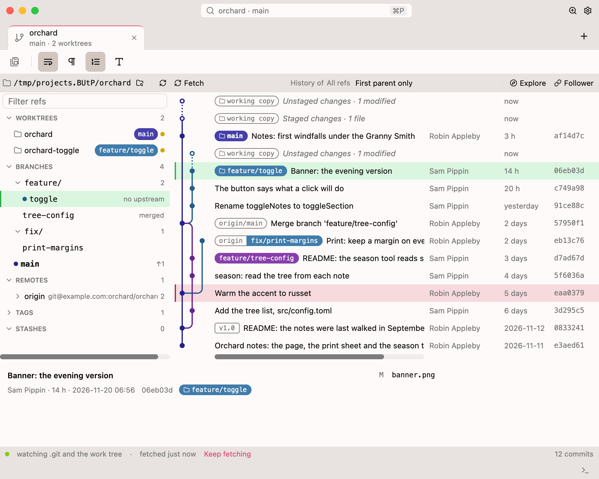

# Bare Compare

Bare Compare is a native folder and file comparison tool for macOS, Windows and Linux, built with Rust and GPUI. It sets two trees, two files, or two points in a git history side by side and keeps them aligned while you read, scroll and edit.

## Folders and files, side by side

Compare whole trees, then open any pair. Rows stay aligned, with character-level highlights inside changed lines. A file or folder that was moved or renamed is paired with where it went, rather than shown as one deletion and one addition.

Both panes are real editors: fix a difference where you see it and save, without a round trip to another tool.

## Git repositories

Open any folder inside a git repository and Bare Compare shows the repository itself in a tab: its branches, worktrees, tags, stashes and the commit graph. Set any branch, tag or commit against your working copy, or against another commit, with nothing checked out.

## More than text

Images open as pictures, side by side, with a heat map or an onion skin of what changed. Any other binary file opens as hex. A zip archive opens as if it were a folder and can be compared against the real one.

## Built for big

Huge directories and multi-gigabyte files open without loading everything into memory, and stay scrollable while they compare. Many comparisons stay open in tabs, across windows, and a command line opens new ones in the app that is already running.

## Offline by design

No account in the app, no activation server, no phone-home. Your files never need the network.

[barecompare.app](https://barecompare.app)
