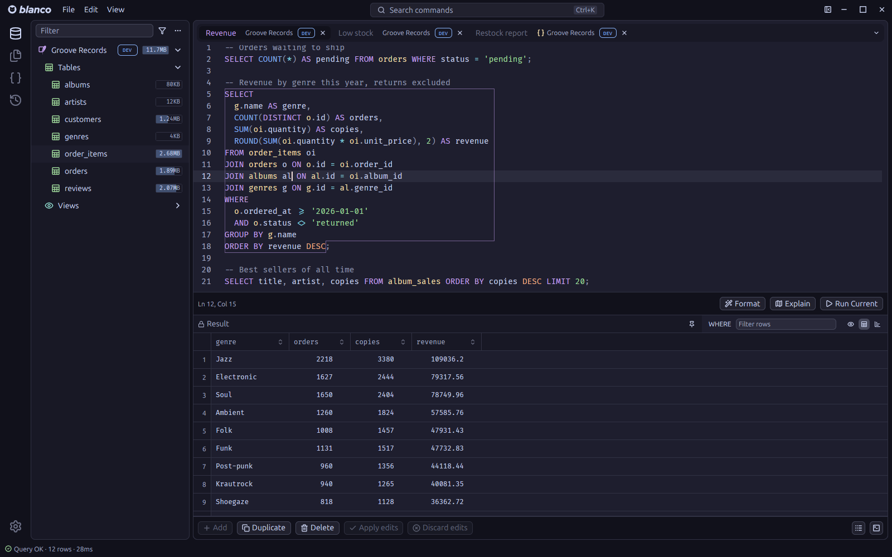

# Blanco

Blanco is a cross platform SQL editor and database client. It connects to PostgreSQL, MySQL and MariaDB, SQLite, DuckDB, SQL Server, CockroachDB, ClickHouse and Redis from one native window, and keeps every tab grouped under the connection it runs against.

## Write queries with the schema at hand

Completion knows the tables, columns and functions of the connected database, including user defined functions, and a signature popover shows the parameters of the call under the cursor. Queries can be formatted and linted, and Blanco runs the statement at the cursor or the current selection. Bind parameters are prompted for before a statement runs. Query history and saved snippets bring earlier work back. EXPLAIN output for PostgreSQL, MySQL and SQLite is drawn as a plan tree with time bars for the hottest nodes.

## Edit results in place

The results grid is editable. Change cells, add, duplicate or delete rows, then apply every edit as one transaction or discard them. Rows can be filtered, copied or exported as CSV, TSV, JSON, SQL or Markdown, charted, and followed through their foreign keys.

## Explore and change the schema

The sidebar shows each connection's schema as a filterable tree, with rename, truncate and drop from the tree. The table structure view edits columns and indexes, object DDL is one click away, and an ER diagram maps how tables relate. CSV and JSON files can be imported with column mapping and a choice of conflict strategies, applied as a single transaction.

## Script your database

Script tabs run JavaScript in a sandboxed QuickJS runtime with access to the connection through `db.query`, `db.execute` and `db.transaction`, and display their results in the same grid as a query.

## Work alongside a coding agent

Blanco includes a terminal and a local MCP server, so a coding agent started next to the editor can read the schema and run queries against the open connections, within a write policy you control.

## Stay safe with production data

Connections can be marked read only, and connections tagged PROD ask for confirmation before any write. SSH tunnels verify host keys against known hosts, TLS is supported, and passwords are kept in the operating system keychain.

The screenshots show Blanco on Linux in the Catppuccin themes.

[Blanco website](https://zanmato.github.io/blanco/) and [source](https://github.com/zanmato/blanco)
