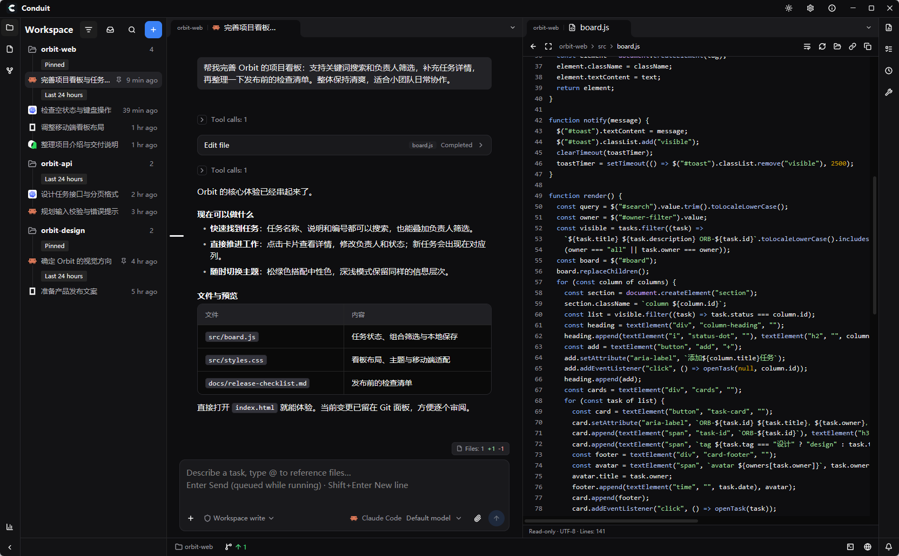
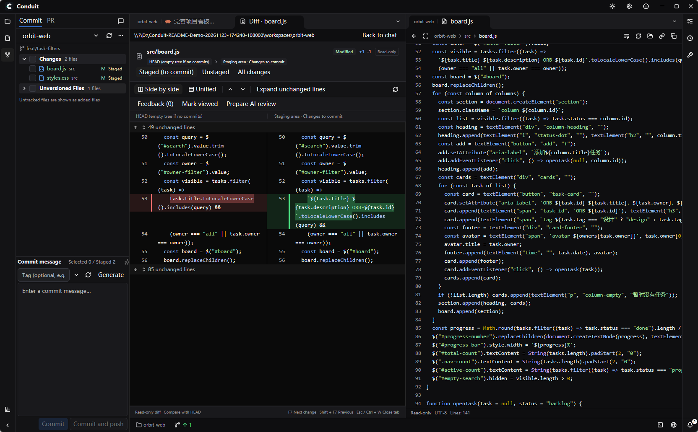
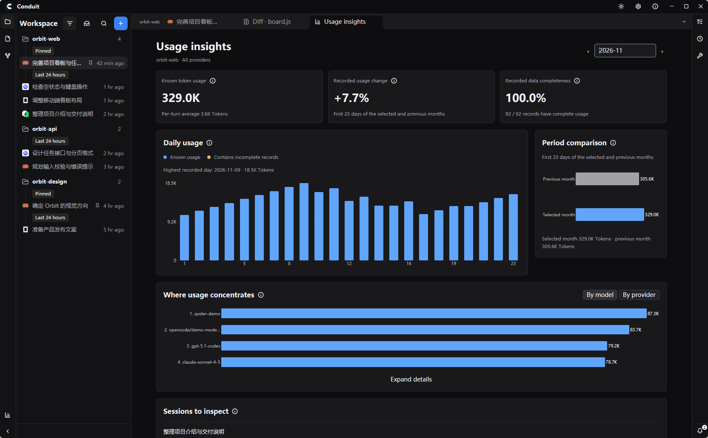

# Conduit

Conduit is a native Windows workspace for AI coding agents. It brings Claude Code, Codex, OpenCode, and Qoder CLI into a shared desktop app, with project conversations, source files, Git review, and a terminal close at hand.

Organize conversations by project, run sessions in parallel, and keep a file open beside the task you are discussing. Streaming replies, tool approvals, attachments, and session history help you follow the work as it develops. Source file and diff previews are read-only.

- **Choose your agent.** Work with the supported coding CLIs through their existing accounts and model services.
- **Keep project context together.** Search conversation history, pin important sessions, and use separate Git worktrees when tasks need isolated working copies.
- **Review changes as you go.** Read source files and Markdown, inspect diffs, and keep workspace terminal tabs available for local development.
- **Make the workspace comfortable.** Choose themes, fonts, backgrounds, and keyboard shortcuts. The interface supports English and Simplified Chinese.

Take changes through Git with file staging, branches, worktrees, commits, and push. Inspect GitHub pull requests or GitLab merge requests, follow checks and discussions, and prepare follow-up tasks from the review.

Usage insights show recorded Token trends, period comparisons, and model and provider breakdowns. These views help you understand the usage recorded for your projects; records with missing usage remain incomplete.

The screenshots show the real Conduit interface with the fictional Orbit demo project. Conversations, tool records, and usage figures are seeded examples for presentation.

Conduit is under active development. The current desktop release supports Windows x64 and uses the selected CLI for coding-agent execution and model access. Conversation history and settings are stored locally.

Built with Rust, GPUI, and GPUI Kit.

[Website](https://leo-lee-j.github.io/conduit/) | [Source](https://github.com/Leo-Lee-j/conduit)
