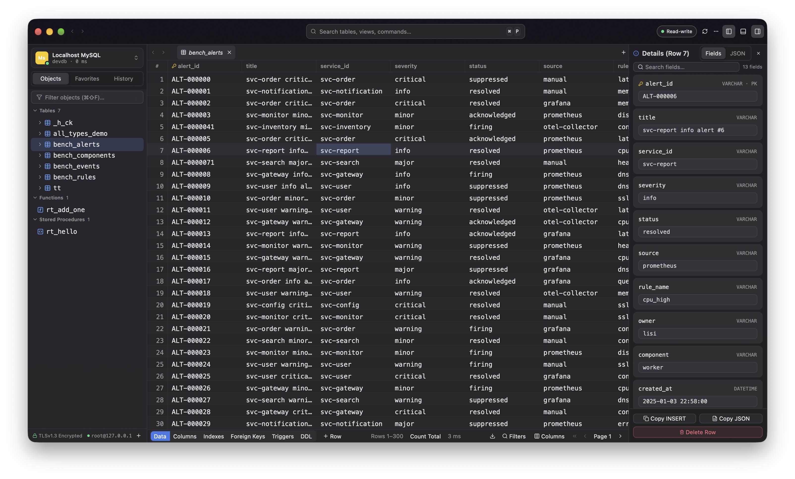
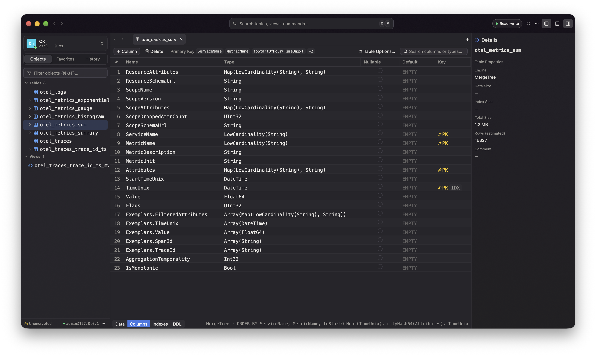

# DbCat

DbCat is a native macOS database client written in Rust with GPUI Kit. It renders on the GPU instead of a browser shell, so it opens instantly and stays smooth while scrolling large result sets.

## Databases

- **MySQL and MariaDB** — tables, views, routines, triggers, sequences, users and privileges
- **PostgreSQL** — schemas, materialized views, sequences, types and extensions
- **SQLite** — local files with zero configuration
- **ClickHouse** — MergeTree table options, partitions and sorting keys
- **Redis** — key browser, typed value editing with command preview, console, Pub/Sub, server info and ACL users
- **MongoDB** — table, JSON and tree views with in-place editing, a mongosh-style query editor, indexes and validation rules

## Features

- Paginated data grid with filters, range selection, inline editing and a floating commit bar that previews every change before it runs
- SQL editor with schema-aware completion, foreign-key JOIN suggestions, query parameters, split panes and a visual execution plan
- Structure editor for columns, indexes, foreign keys and table options, with generated DDL shown before applying
- Connection rail: several connections in one window, switched with a keystroke
- ER diagrams, process lists, import/export and database backup/restore
- SSH tunnels and TLS, passwords stored only in the macOS Keychain
- Workspace restore: windows, tabs and editor drafts come back after a restart

Learn more at https://dbcat.forzens.com
