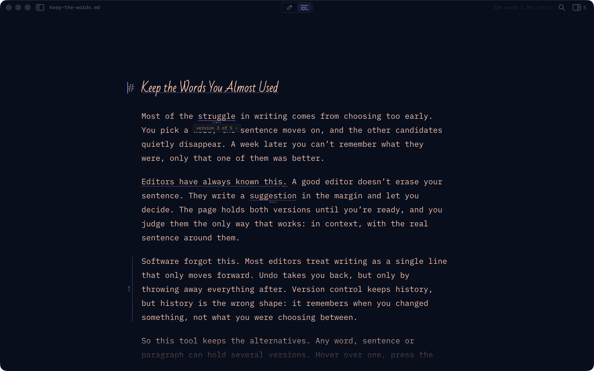
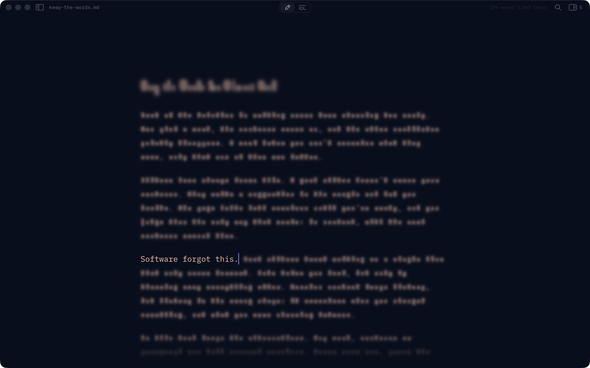
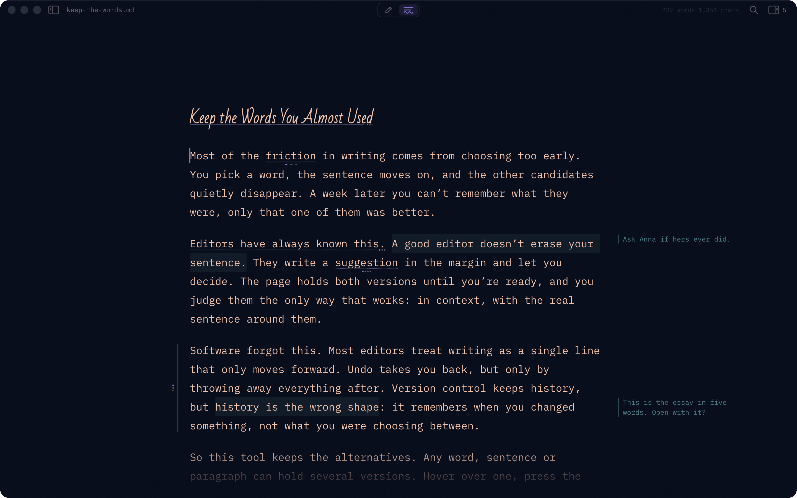
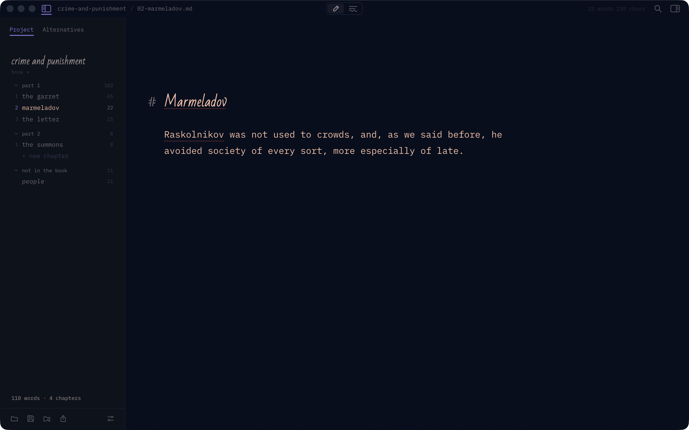

# Dostoevsky

Dostoevsky is a writing app for macOS. While you write, it's a quiet page: no marks, the rest of the draft dimmed, the text hidden when someone's looking. When you edit, it keeps every version of a word, sentence or paragraph where it belongs. Hover over a phrase, press ↓, and read the next version in place. Nothing gets deleted: you choose later, with the real sentence around it.

## Writing mode

No underlines, no dots, no margin notes; the header fades while you type. Zen writing keeps the sentence, line or paragraph you're in bright and fades the rest with distance. Typewriter scrolling keeps the line you're writing in one place. Five light-and-dark themes or your own, and four typefaces.

## Private mode

The page turns to blurred ink, and only the sentence you're writing stays readable, for writing where someone might look. It only paints: the file is untouched.

## Editing

- **Alternatives.** Any span can hold several versions. You flip between them in place and see each one in its real sentence.
- **Cuts.** Cutting keeps what it cuts: the text fades where it was, pasting moves it, and the Cuts panel keeps every cut with its place.
- **Comments.** Leave a note in the margin beside the words it's about. The final text never includes them.
- **Find** looks in cuts, hidden versions and notes too. Statistics shows words, reading time and reading ease, with one formula per language.

## Books and projects

Open a folder and it becomes a project: a book (numbered chapters, in parts), a journal (one dated page a day) or a plain folder. Order lives in the file names, so the folder still makes sense in Finder or git. The list shows each chapter's word count, a notes folder keeps research outside the text, and Find and the Cuts panel reach every chapter.

## Getting it out

The final text is what a reader sees: the version showing in each place, no cuts, no comments. Export a page or a whole book as PDF, Word, ePub, a web page, Markdown or plain text, in your own look, the standard manuscript format, or a typeset book. Word can carry the other versions as comments for an editor.

## One plain file

Everything is saved in one Markdown file that any other editor can still open. Versions, cuts and comments live in HTML comments at its end, so other editors show clean text. Saves are atomic, with autosave and backups.

## Optional AI

AI is off until you connect it, and it never rewrites your text. It suggests and it marks: five ideas for a word or phrase that fit the sentence around it, and Review passes (Fix mistakes, Hard to read, Word choice, Trim) whose marks you accept or ignore. Use OpenRouter, or a model on your own Mac through Ollama, LM Studio or any OpenAI-compatible server.

## Native

Dostoevsky is written in Rust and drawn with GPUI and gpui-kit, without a web view. It is free and open source, and runs on macOS 13 or later, on Apple silicon and Intel. The interface is available in seven languages.

Website: https://dostoevsky.app
Source: https://github.com/meroving/dostoevsky
