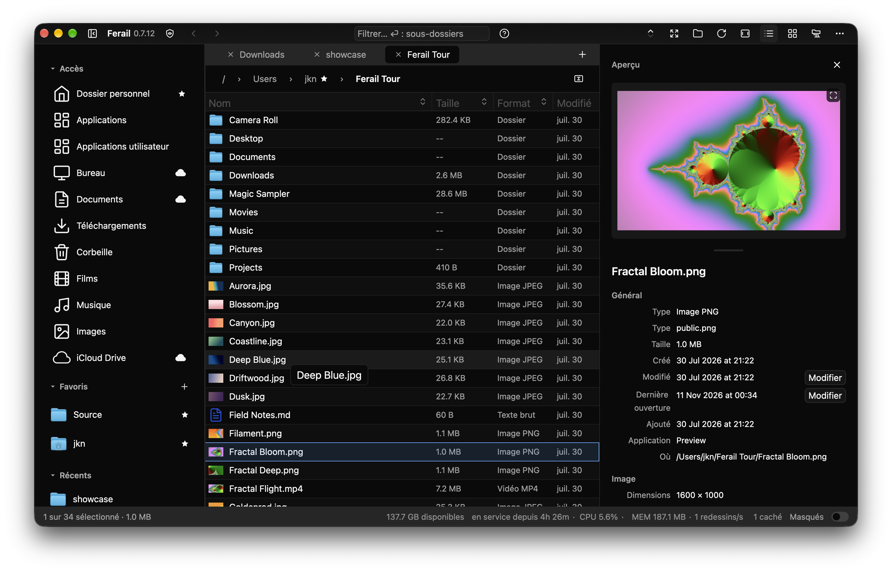
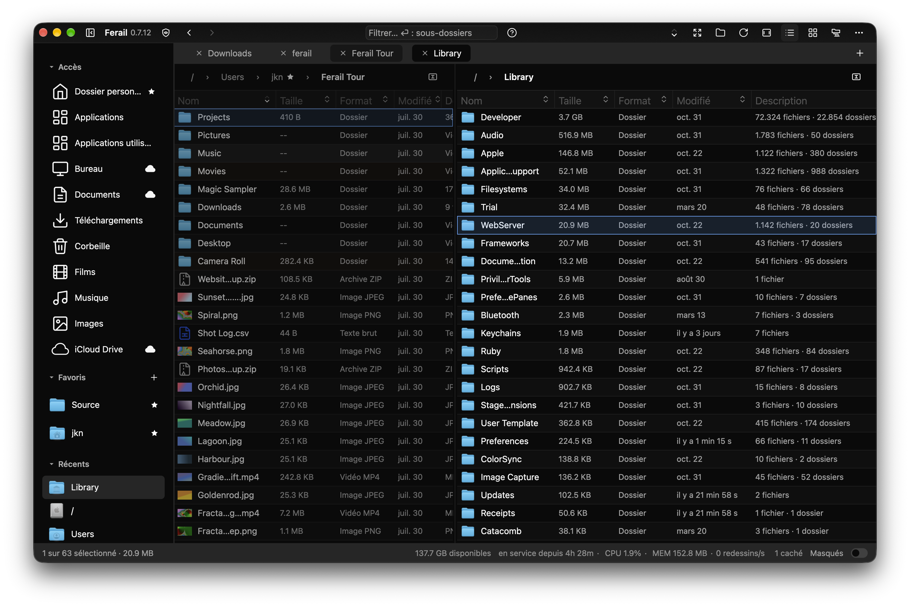
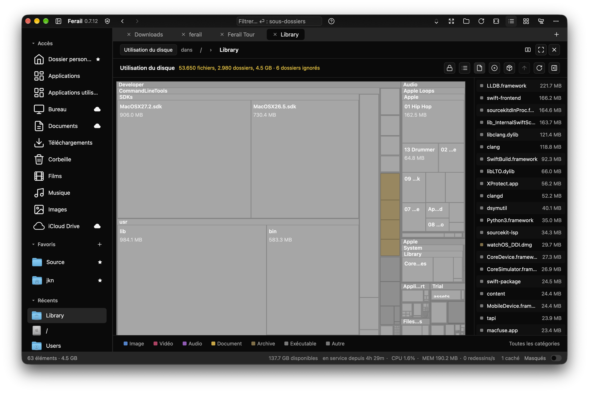

# Ferail

Ferail is a file manager for power users, built on two things:

- **The UI never stops.** No work runs on the UI thread: listing, sorting,
  icons, previews, file type detection and every disk or network call happen
  in the background. Scrolling and typing stay smooth on a slow network share
  or a sleeping external drive.
- **A whole disk in one list.** Flat View streams every file under a folder,
  or under the root of a drive, into a single list you can scroll, filter and
  act on. There is no row cap: it has shown more than 5 million files in one
  view.

## Browse

- Tabs, and a split view that shows two folders side by side or stacked,
  with copy and move to the other pane from the keyboard.
- List and icon grid views, a preview pane with file details, and a
  full-screen viewer for images, video, audio and documents.
- A command palette, a filter that searches subfolders, and keyboard
  shortcuts for every command.
- Favorites, Recents and the Ant Trail, which tints the folders you visit
  most so frequent places stand out.

## Understand your disk

- Disk Usage draws a treemap of any folder and lets you drill into it.
- The duplicate finder groups identical files by content and finds similar
  images, without sending anything off the machine.
- File types are identified from their content, not only their extension,
  and each file gets a short description: image size, video length, archive
  contents.

## Work with files

- Bulk rename with a live preview.
- An archive workbench to browse, extract and create ZIP, 7z, TAR and other
  archives.
- Filename hazard warnings for names that break on other systems.
- File operations can be undone with Cmd+Z, a whole bulk rename included.

## Respect your privacy

A Privacy page decides what Ferail remembers. Remember nothing keeps the
session in memory only, folders can be excluded from history, and every kind
of stored trace can be cleared with one button.

## Platforms

Ferail is signed and notarized on macOS, its primary platform, and also runs
on Windows and Linux, in English, German, French, Italian and Polish. It
also runs natively on AROS, the open-source AmigaOS-compatible operating
system, through an AROS backend for GPUI; that port is in progress.

Ferail is built with GPUI and GPUI Kit, and is open source under MIT or
Apache 2.0.
