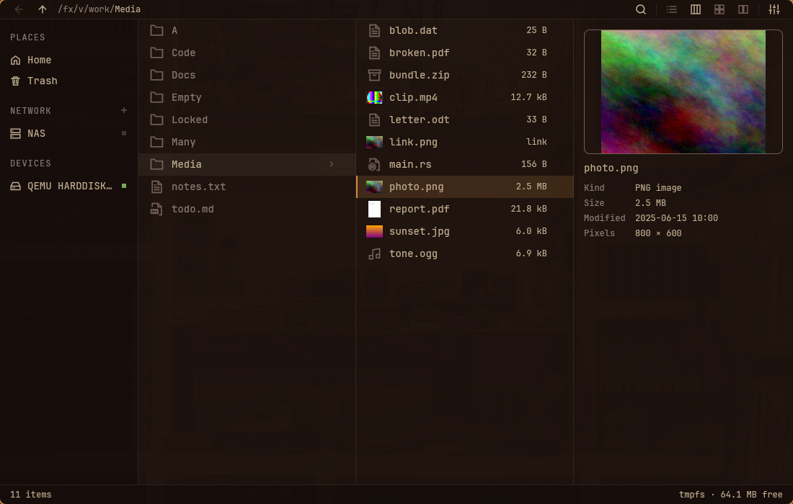
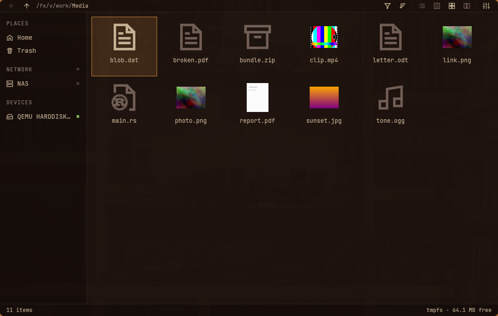
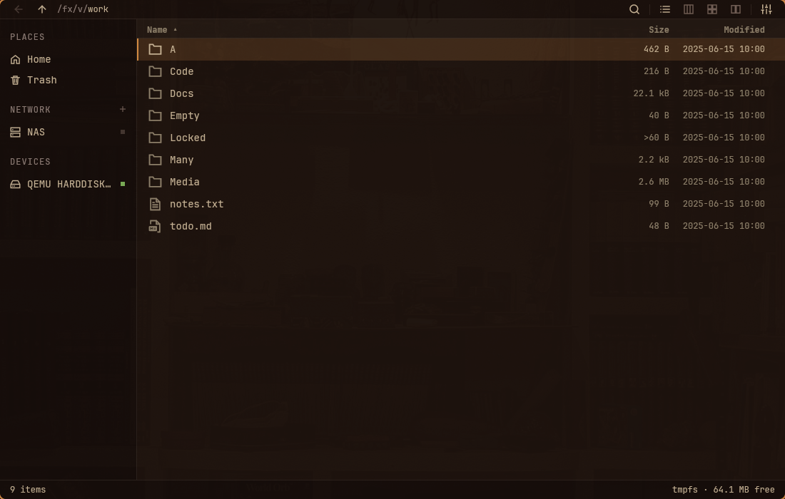

# Flea

Flea is an Omarchy-first file manager for Linux, written in Rust with a native GPUI interface and a companion terminal interface.

## Browse your way

Switch between Columns, List, Grid and Dual views. Keep folder navigation, selection and previews together, or browse two locations side by side for file operations.

## Preview before opening

Inspect images, PDFs, Markdown, source files, audio, video and other supported formats without leaving the file manager. The Columns view can keep a preview beside the files you are browsing.

## Work with files

Search names and file contents, filter a folder, manage tags, inspect properties and perform common file operations. Keyboard controls, localization and Omarchy theme integration keep the application at home on the desktop.

[Project source](https://github.com/thisisgm/flea)
