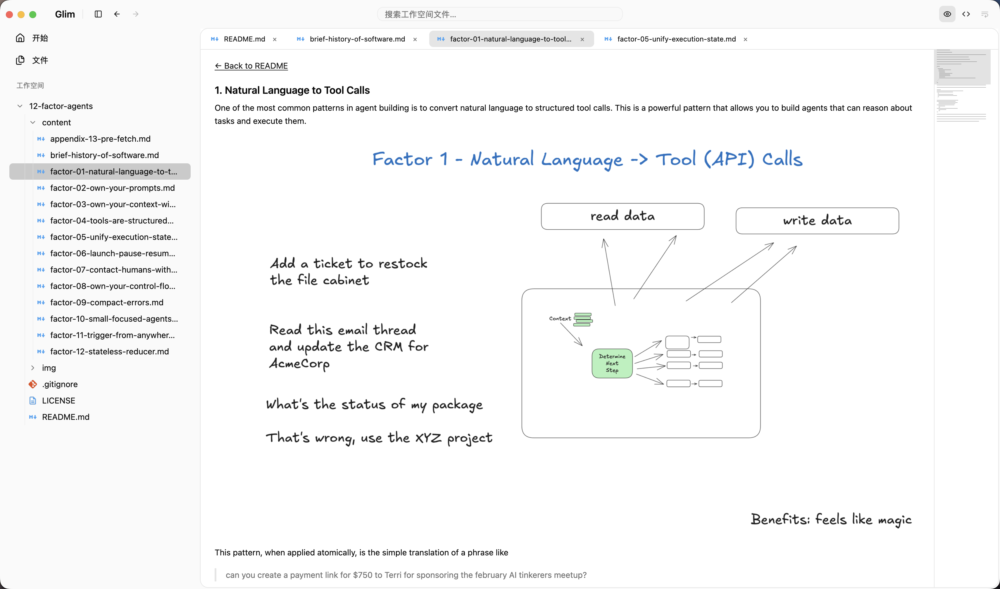

# Glim

Glim is a free, open-source, all-purpose file viewer for Mac, built with Rust and GPUI Kit. It brings documents, data, images and source code into one workspace, with support for Apple Silicon and Intel.

The screenshot shows the public 12-factor-agents documentation; its text and illustration belong to that project.

## Read different files in one workspace

- Markdown reading with tables, diagrams and formulas, plus access to the editable source.
- Expandable JSON trees and CSV tables, with source views for checking the original text.
- PDF, image and Office document previews. Office previews are read-only and depend on macOS support.
- Source-code highlighting and basic UTF-8 text editing, with undo, redo and automatic or explicit saving.
- EPUB reading with bookmarks, and read-only SQLite table inspection.

A resizable file sidebar, document tabs and workspace search keep related files together. Previewing a supported file is not a promise of full format compatibility or complete document editing.

## Open source

Glim is MIT-licensed. The [source repository](https://github.com/NeoPanic/Glim) contains the supported formats and project documentation.
