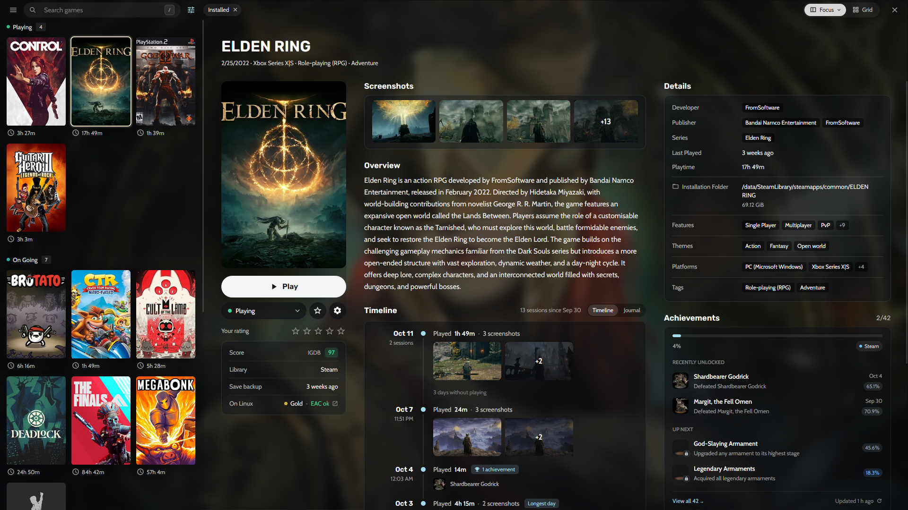
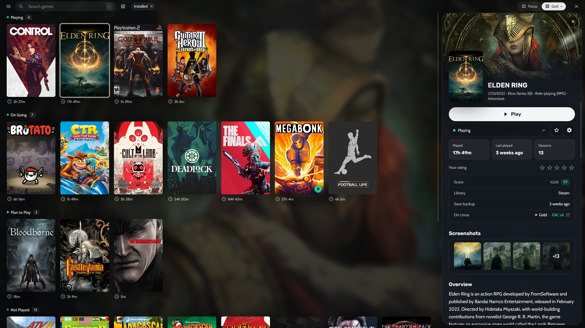
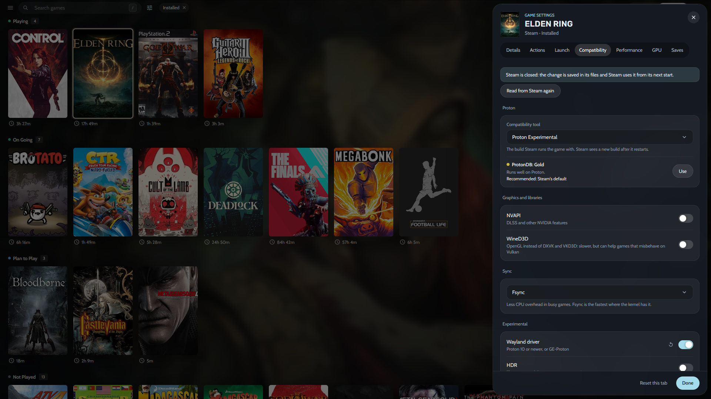
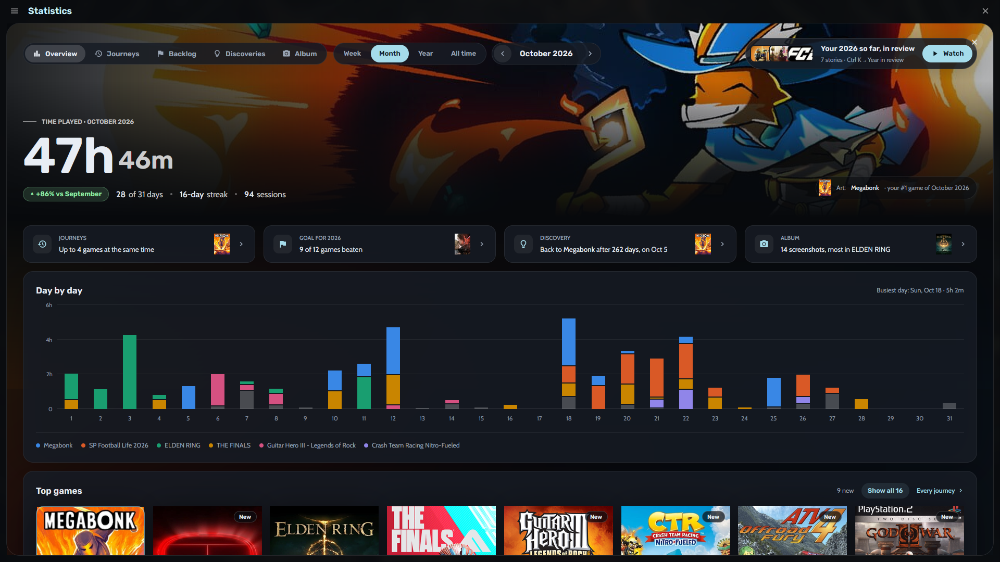
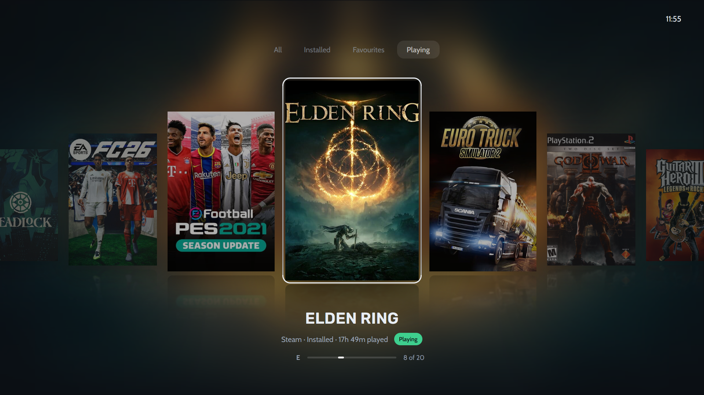

# Heronite

Heronite is a game launcher for Linux and Windows that brings your games from Steam, Epic Games, GOG, Amazon Games, Battle.net, EA app, Ubisoft Connect and Rockstar Games, plus emulated, native Linux and Windows games, into one Collection. It launches them natively, through Wine or Proton on Linux, or through an emulator, and records every session.

It is written in Rust with GPUI and GPUI Kit as one native process with no bundled browser. The library is on screen in about 215 ms, the app uses about 190 MB of memory while idle and about 95 MB closed to the tray, and idle CPU use stays around 0.1%. Downloads, folder scans and metadata run off the UI thread, so the interface keeps responding while they work.

## One Collection

Show the library as a list with details or as a grid of covers, grouped by play status, store, genre, series or year. A game's page shows its screenshots, How Long To Beat, achievements and a timeline of every play day, and a journal keeps notes next to your screenshots. Filter, sort and save views such as Playing now or Backlog, change many games at once with undo, and reach any page, action or game from the command palette. Search forgives typos.

## Stores and launchers

Log in to Epic Games, GOG and Amazon Games to install, update, repair or move games from one download queue. On Windows, games already installed by their official launchers come in without downloading again. Steam libraries show up by themselves, with no login. On Linux, Battle.net, EA app, Ubisoft Connect and Rockstar Games each run in their own Wine prefix and their games join the Collection. Games can be imported and kept in sync from Heroic, Lutris, Bottles and Faugus on Linux, and from Playnite on Windows.

## Configure and play

Every game has its own settings. On Linux they cover the Wine or Proton build and prefix, DXVK, gamescope, an FPS limit, DLSS and FSR upgrades, Winetricks and Lossless Scaling frame generation. The Wine Manager downloads and updates Proton-CachyOS, GE-Proton and other builds, and manages prefixes. Launches can run scripts before and after, start programs alongside the game, and reuse presets. A sandbox runs untrusted games without network access or access to your home folder.

Emulators are detected by themselves or added with RetroArch cores, with ROM scanning and save states. On Linux, an in-game overlay opens volume, the FPS limit, screenshots and notes over the game, and a replay buffer saves the last seconds of play.

## Look back at what you played

Every launch is recorded, and screenshots are matched to their game. Statistics show play time by week, month or year, streaks, journeys of games played at the same time, a yearly backlog goal and discoveries about how you play. Year in review turns the year into full-screen stories, with a card to share.

## Console mode

A controller-first layout for the couch or a TV, with eight layouts such as Shelves, Spotlight, Cinema, Grid and Wheel, and your own covers, colours, fonts and menus. Seven themes come built in, and your own can be exported and shared as a file. Nothing of it loads until you turn it on, and it can open at startup or when a controller connects.

Heronite is translated into English, German, Spanish and Brazilian Portuguese, and is open source under the GNU General Public License v3.0.

[Official website](https://heronite.app)

[GitHub repository](https://github.com/RafaelGoulartB/Heronite)
