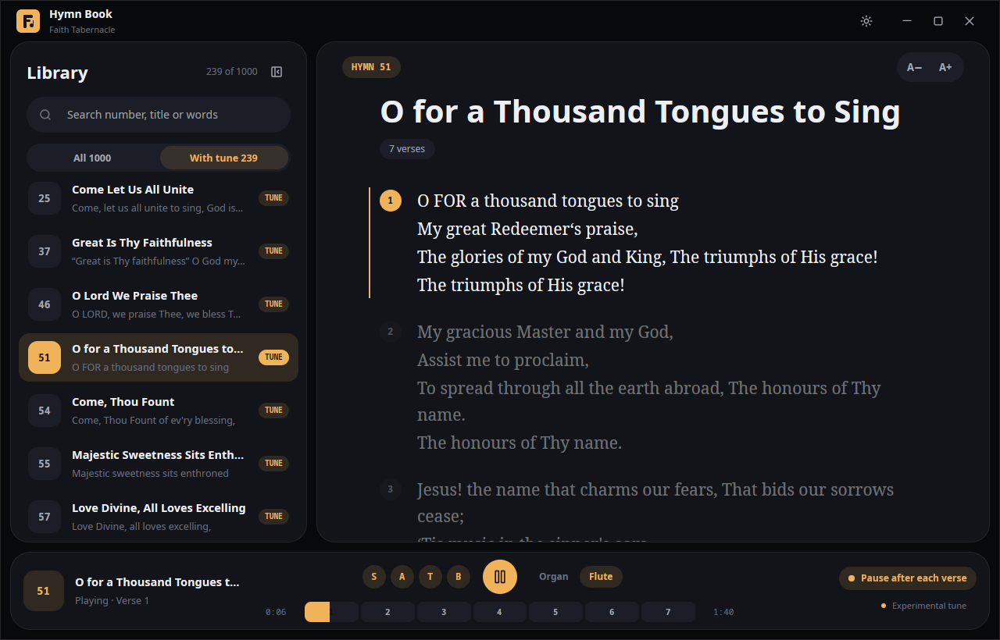
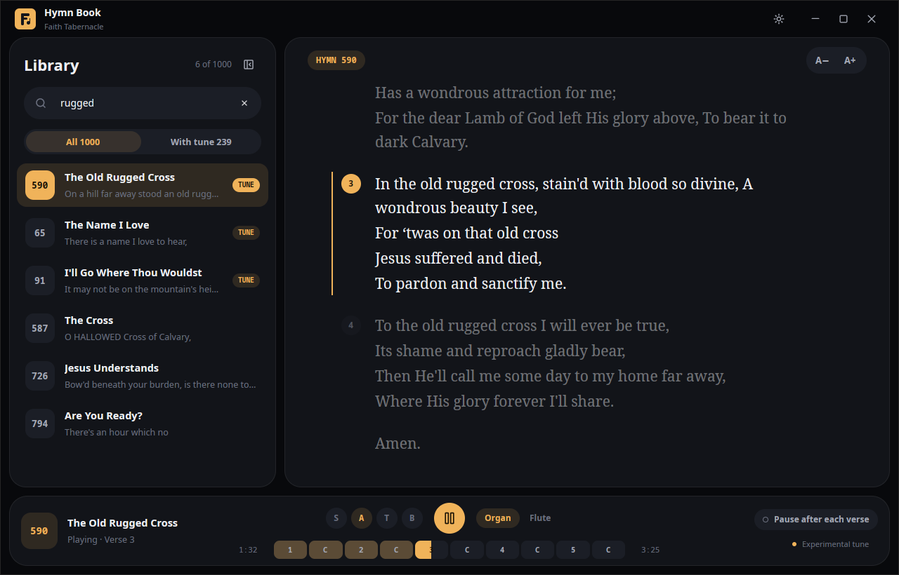
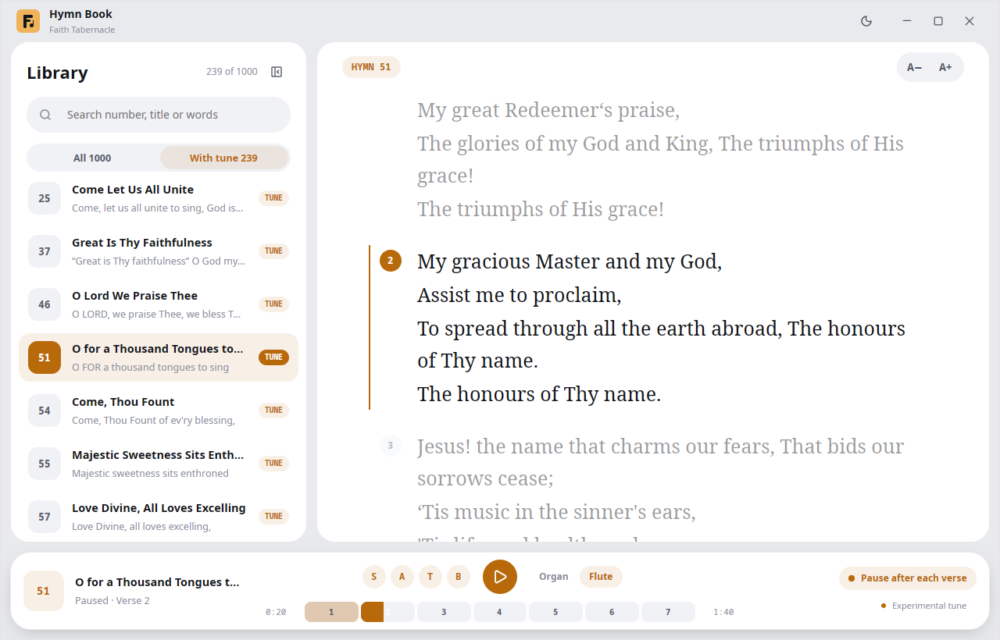

# Hymn Book

Many people know the words of their hymns but have forgotten how the tunes go. **Hymn Book** puts the whole Faith Tabernacle hymn book on the desktop and plays the tune of each hymn the way it is actually sung: verse, chorus, verse, chorus.

## What it does

- **Browse and search all 1,000 hymns** by number, title, or any line you remember. Verses, choruses and voice parts are laid out clearly.
- **Hear the tune** on a church organ or a flute. Tunes are labelled experimental, and more are being added.
- **Song map.** A bar of verse and chorus segments shows the whole song. Tap any segment to jump straight to it.
- **Pause after each verse.** Sing at your own pace, then press play for the next verse.
- **Voice parts.** Switch Soprano, Alto, Tenor and Bass on or off to learn a single line.
- **Lyrics that follow the song.** The verse being sung is highlighted and eased into view while the others fade back.
- **Light and dark themes**, adjustable lyric size, and a smooth animated library panel. It works fully offline.

## Built with GPUI Kit

The interface is written in Rust with GPUI and GPUI Kit components. Tunes are converted from public-domain scores into four-voice MIDI and arranged into the full song at play time, joined on exact sample boundaries so nothing clicks or drops out.

## Who it is for

Singers, choir members and anyone learning or teaching hymns who want to hear how a tune goes before they sing it.

Website: https://hymnbook-two.vercel.app
Source: https://github.com/ugochukwu-850/hymnbook
