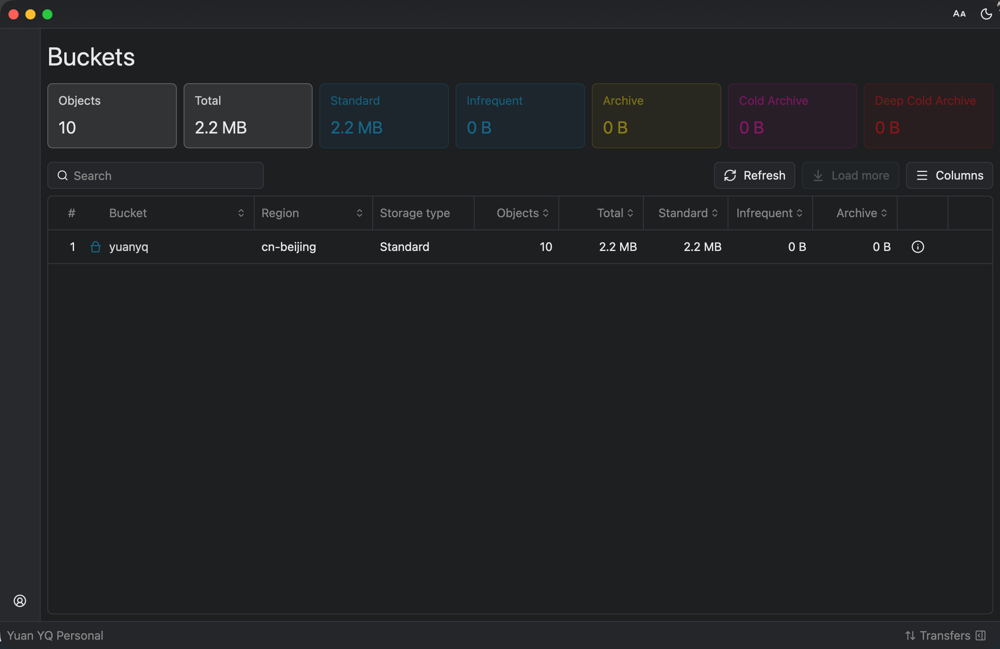
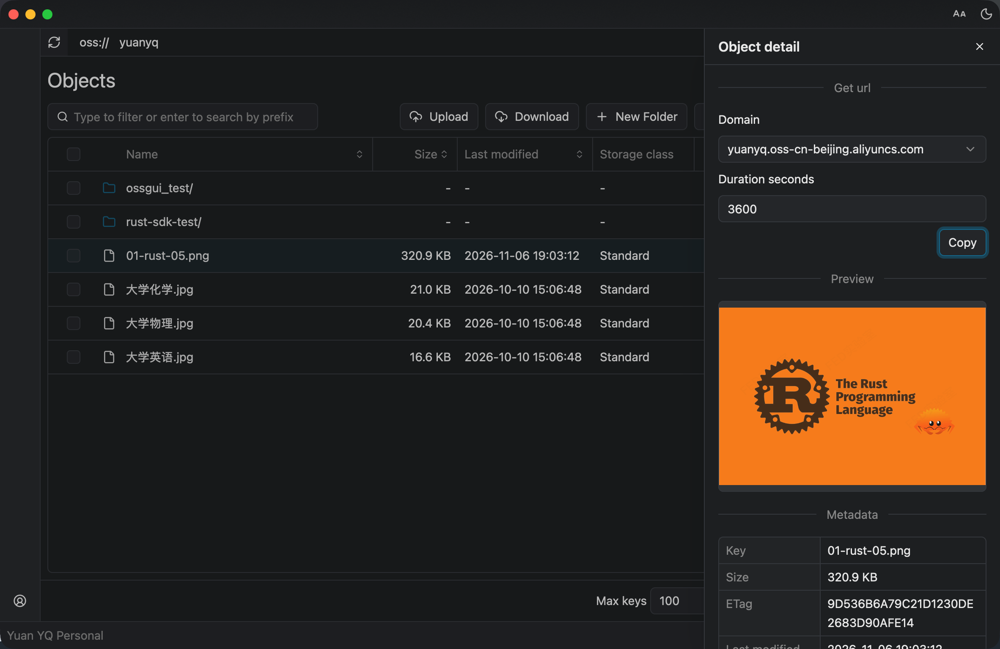
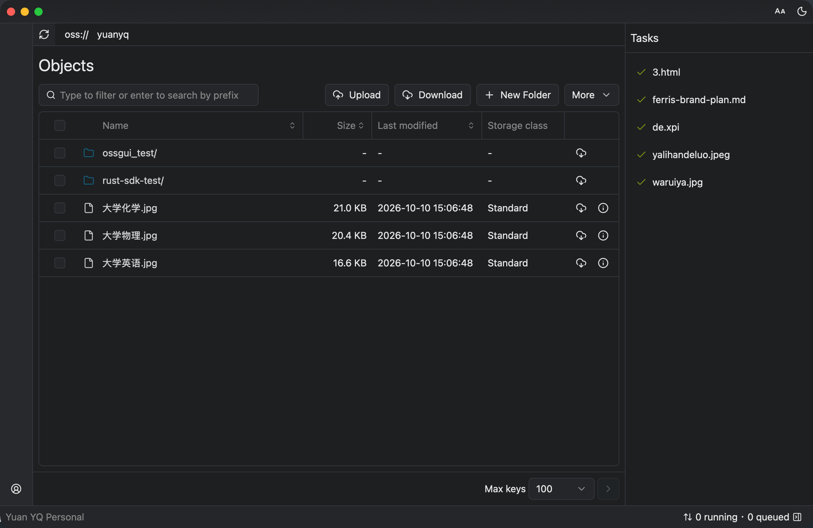

# Ossgui

Ossgui is a cross-platform desktop client for Aliyun OSS (Object Storage Service), written in Rust with GPUI Kit. Accounts, buckets, objects and transfers all live in a single window, with no browser engine underneath.

## Accounts

Several accounts can be configured side by side and switched with one click. Each account keeps its own region and AccessKey pair, and the OSS endpoint follows that region, so buckets belonging to different accounts are never mixed. Credentials are stored in the operating system's own secret store — the macOS Keychain, the Windows Credential Manager or the Linux Secret Service — and are not written to disk by the application.

## Buckets

The bucket list shows every bucket of the active account together with its region, storage class and object count. Usage is reported for all five OSS storage classes — Standard, Infrequent Access, Archive, Cold Archive and Deep Cold Archive — so the distribution of a large account is visible at a glance. Statistic columns are sortable, and a summary row aggregates the account as a whole.

## Objects

Objects are browsed with breadcrumb navigation, and the current prefix can be filtered instantly while typing, or searched on the server side by pressing Enter. Uploads start from a file picker, from a folder, or by dropping items from the file manager into the window. New folders are created in the current prefix, and a long listing is paged through in batches of up to a thousand objects. Downloads handle a single object or a whole folder recursively. Objects can be multi-selected for batch deletion, or deleted one row at a time.

Each object has a detail view: images get an inline preview, and every object reports its size, ETag, last modified and last accessed time along with any custom metadata. A presigned URL for the object can be copied with one click for sharing outside the application.

## Transfers

Uploads and downloads run in the background against a Tokio runtime, while the window stays responsive. Progress is reported per transfer, so a batch of files can be followed without blocking the object browser.

## Scope

Ossgui covers browsing, searching, upload, download, deletion and account management. Bucket-level administration — creating, deleting and configuring buckets — is deliberately left to the OSS console for now.
