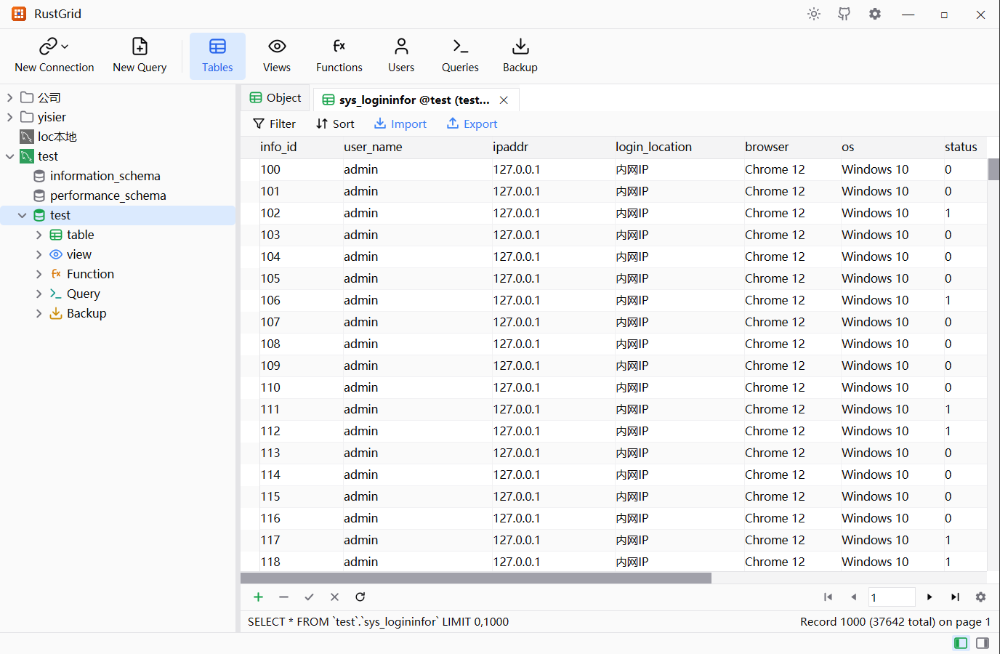
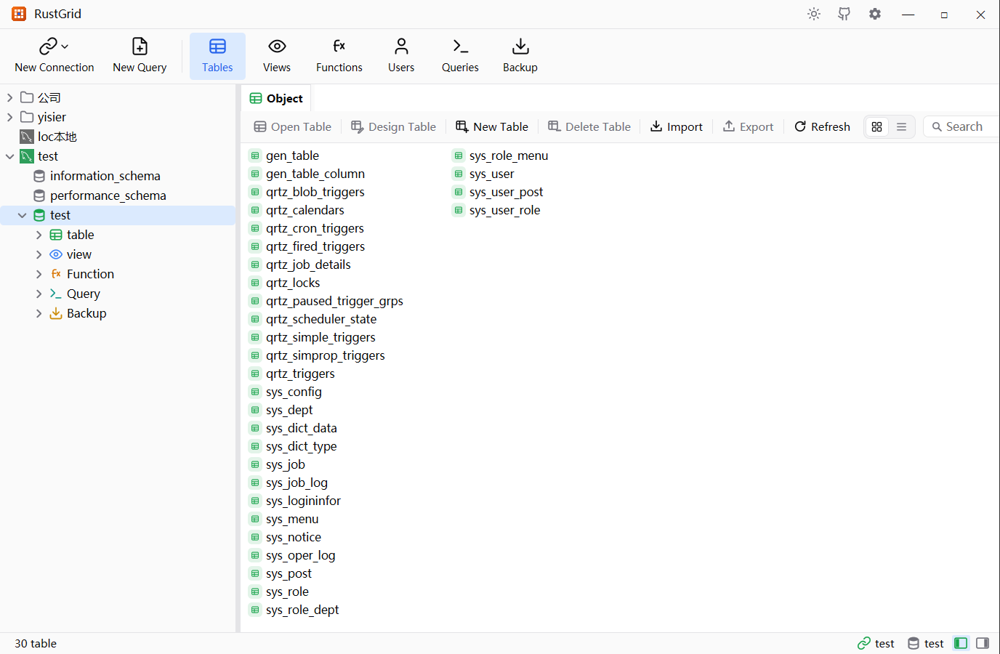
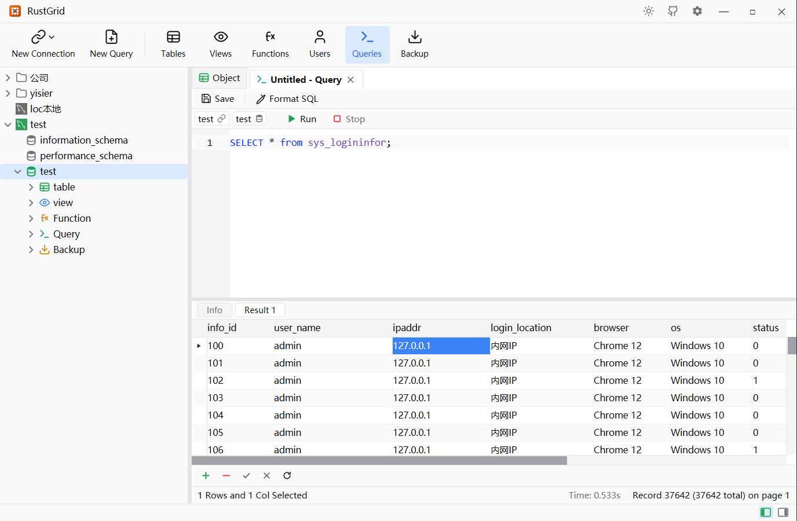
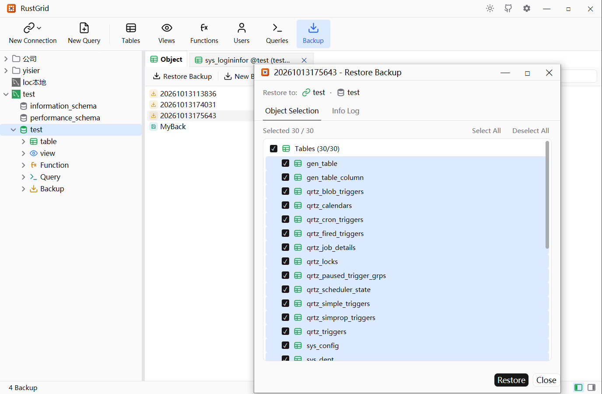

# RustGrid

RustGrid is a native, cross-platform database management tool for Windows, macOS and Linux, built
in Rust on GPUI. It follows Navicat's layout and interaction model — the connection tree on the
left, object lists and a data grid on the right — so the workflows database users already know
carry over unchanged. Rendering is GPU-native: no embedded browser engine and a single small
executable.

## Object browsing and the data grid

Tables and views open in a paginated grid with in-place editing. Rows, cells and multi-cell ranges
can be edited, inserted and deleted directly in the grid, an Excel-like selection supports
Shift and Ctrl multi-range picking, a filter builder composes nested AND/OR conditions, and the
status bar reports the executed statement, the selected range and the total record count. Date and
time columns edit through an in-place calendar and time picker.

The connection tree holds groups and connections with drag reordering, and each connection can be
given an environment colour so production stands out at a glance. The object list keeps Navicat's
column-major layout and shows each table's engine, row count, data length, auto-increment value,
modification date and comment. Tables and views can be opened, designed, renamed in place,
emptied, truncated or dropped through a shared confirmation dialog.

## SQL editor

The query editor offers SQL syntax highlighting, keyword and table-name completion, a Beautify
command, a query plan explain, and results in a grid that supports the same editing as the table
grid whenever a single table can be inferred. Named queries are saved per connection and database
in a sortable list, and several editor tabs can run against different connections at once.

## Backup, restore and data transfer

RustGrid writes its own compressed backup container, so a database or a subset of its objects can
be archived and restored with object-level selection. An export wizard writes table data to Excel,
CSV, SQL or text with a per-table column selection, and an import wizard reads Excel workbooks and
delimited text, mapping source columns onto destination fields, creating tables whose column types
are inferred from the data, and reporting progress as it runs.

## Administration

- **Connections** — create, edit and delete profiles, connect and disconnect, prompt for a
  password, and reach servers through SSH, SOCKS5 or HTTP tunnels. Passwords are encrypted on
  disk and never stored inside a profile.
- **Databases** — enumerate databases, create, edit and drop them with a charset and collation,
  and edit their defaults.
- **Users** — list server accounts and manage identity, authentication, resource limits, server
  privileges, per-database object privileges and role membership in one editor, with a SQL
  preview of the script to be executed.
- **Routines and views** — design stored functions and procedures with their definition,
  metadata and SQL preview, and design views with definer, security and algorithm options,
  previewing the result before saving.
- **Connection import and export** — import connection profiles from RustGrid bundles, Navicat
  exports or DBX files, and export them again with passwords optionally included.

## Supported engines

| Engine | Access |
| --- | --- |
| MySQL and MariaDB | Native driver |
| PostgreSQL | Native driver, schema-qualified objects |
| Microsoft SQL Server | Native driver |
| Oracle | Native driver, no client libraries required |
| SQLite | Native driver, one file per database |
| DB2, Dameng, and other sources | Generic ODBC |

## Appearance and language

A light, dark or system theme is applied across the whole interface, and the UI is available in
English and Simplified Chinese.

RustGrid is open source under the Apache License 2.0:
https://github.com/yisier/rustgrid
