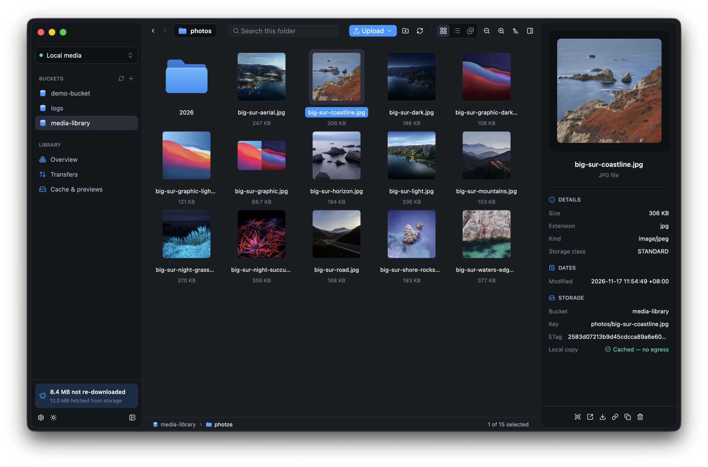
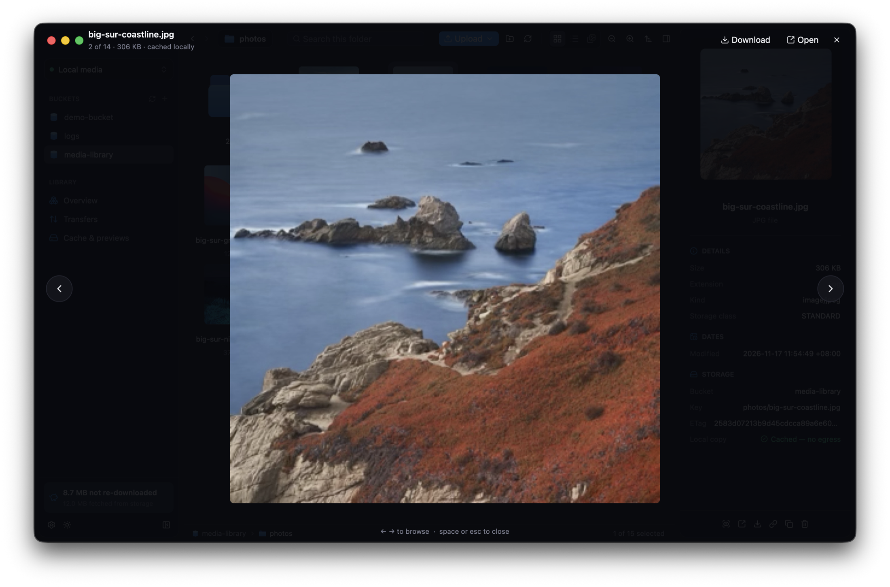

# S3 Browser

S3 Browser is a fast, native macOS file manager for Amazon S3 and every S3-compatible storage service. It lets you browse buckets like a local drive, with thumbnails, Quick Look, folder sizes and a local cache that keeps you from paying egress twice for the same file.

It is built in Rust with GPUI Kit. Source: https://github.com/zf0x00/s3-browser

## Highlights

- **Explorer layout.** Grid, list and media views with real image thumbnails, a floating sidebar and an inspector panel showing size, type, storage class, dates, key and ETag.
- **Quick Look.** Press Space to preview an image full-size, and use the arrow keys to flip through the folder.
- **Pay egress once.** Every file and thumbnail you fetch is cached on disk and checked against the object's ETag. Re-opening, previewing or downloading it again costs nothing, and the sidebar shows how much you've saved.
- **Works with any S3 store.** Presets for Amazon S3, Cloudflare R2, MinIO, Backblaze B2, Wasabi, DigitalOcean Spaces, Google Cloud Storage, Akamai/Linode, Scaleway, Hetzner, or any custom endpoint. Credentials can be imported from existing AWS or s3fs credential files.
- **Folder sizes.** S3 has no real folders, so S3 Browser adds them up for you. Select a folder to see its total size and file count.
- **Native Mac app.** Real menu bar and keyboard shortcuts, light and dark themes, drag-and-drop upload from Finder, and secret keys kept in the macOS Keychain.

## Use cases

- Browsing and previewing media libraries stored in S3 or R2 without downloading everything first.
- Checking what is in a bucket, how big a prefix is, and which storage class objects use.
- Uploading files and folders by dragging them in from Finder.
- Working across several providers and accounts from one window.
