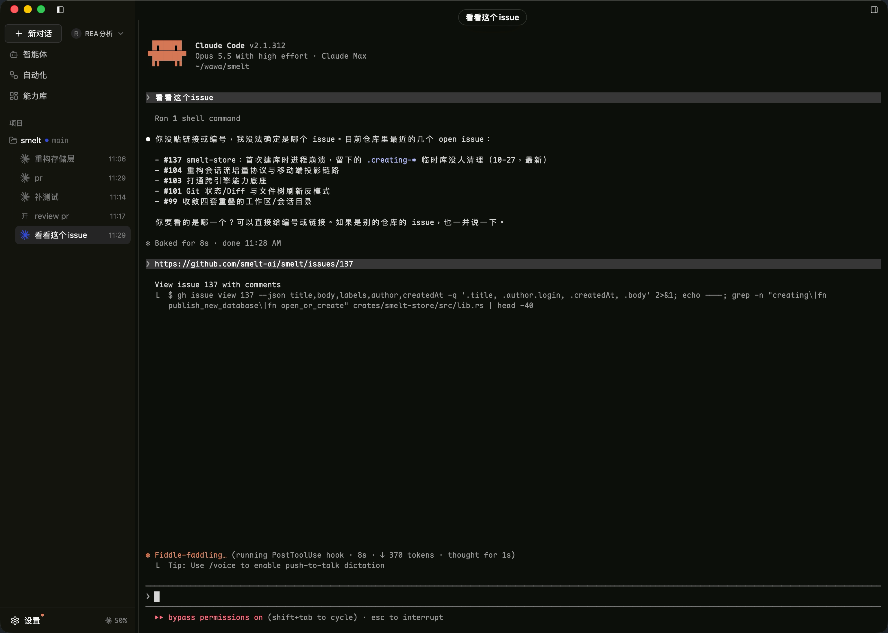
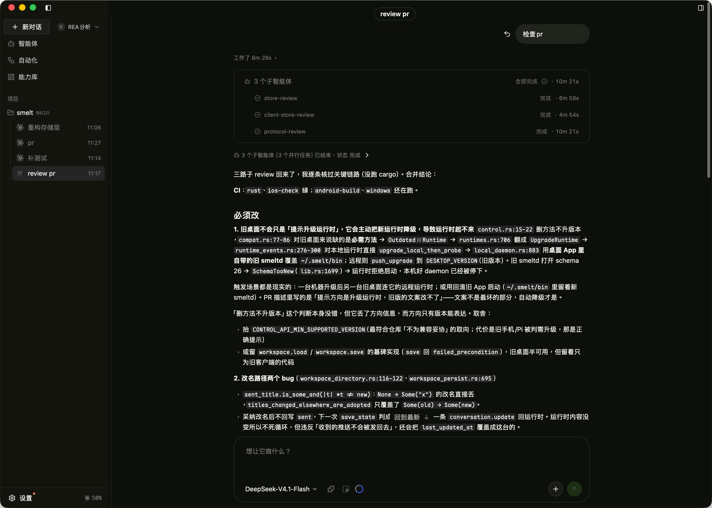
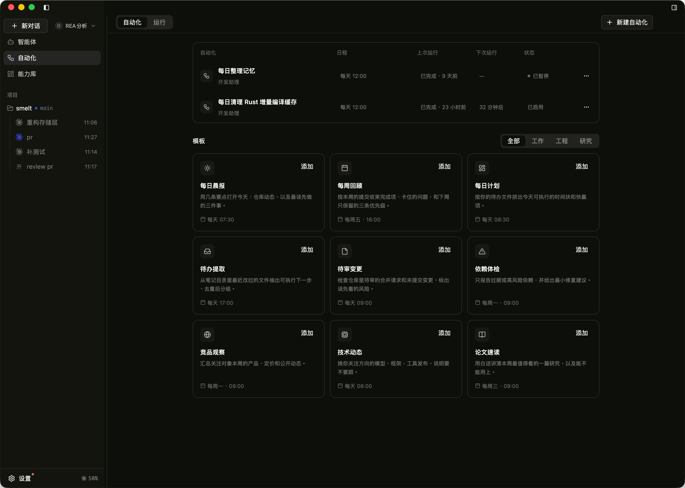
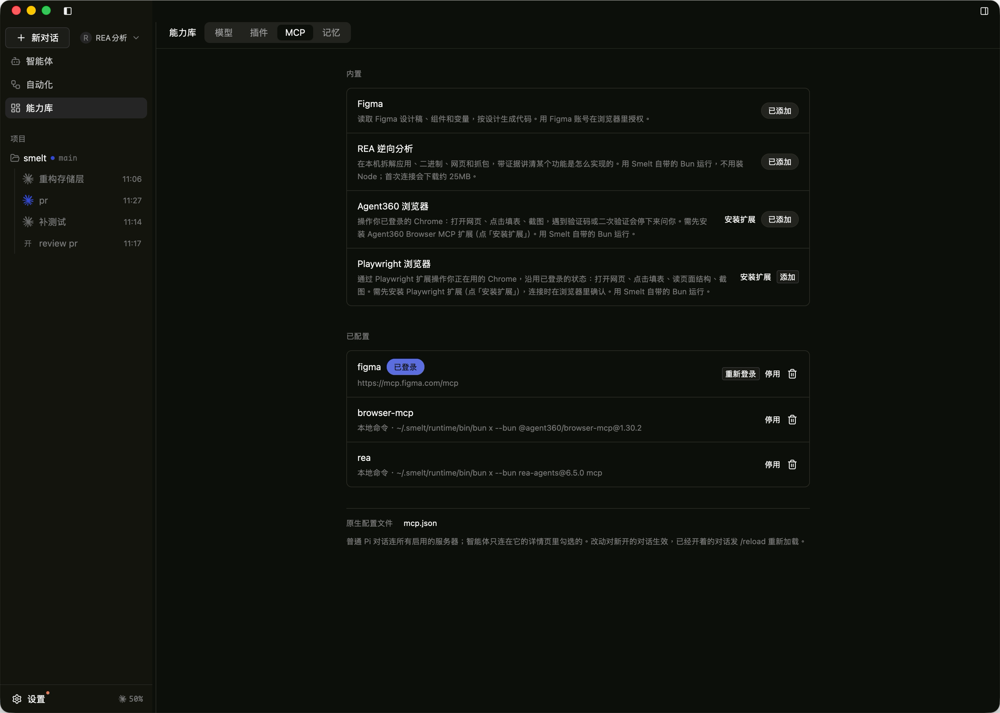

# Smelt

Smelt is an AI coding cockpit for macOS and Windows. When agents can read code, edit it, run tests and commit on their own, the developer's job shifts from typing to steering. Smelt is the native desktop workspace for that job: many projects, many tabs and many coding agents side by side, with the terminal, where agents actually work, as the primary surface.

## Any agent, in a real terminal

Every tab is a real embedded terminal that runs interactive programs and full-screen TUIs, so Claude Code, Codex, GitHub Copilot, Pi, Vim or htop behave exactly as they do in a standalone terminal. Split panes, stacked terminal docks, a command palette and customizable quick launchers keep a busy workspace navigable. Terminal sessions live in a separate runtime process, so they survive the window closing or crashing and reattach on the next launch.

## Native agent conversations

Claude Code, GitHub Copilot, Codex, Grok, Cursor, OpenCode, Kiro, Crush and Pi can also run as structured conversations over ACP or their native protocols. Messages stream in with tool cards, inline diffs, permission prompts and plan progress, and sessions can be resumed later with the same model, permission mode and reasoning effort. A Pi conversation can fan work out to subagents running in parallel; each one shows its own status and timing in the conversation, keeps its own session that can be opened and followed, and hands only its result back.

## Know which agent needs you

Session state comes from agent hooks and structured protocols rather than scraping terminal output. Badges and system notifications point at the sessions waiting for a decision, so attention goes where it is needed instead of to whichever tab happens to be in front. Account usage for Claude, Copilot, Codex, Cursor and Grok is shown per provider, and past sessions from each agent's local transcripts can be browsed and reopened.

## Persistent agents and automations

The Agents workspace keeps reusable agent definitions. Automations run them, or plain shell tasks, on a schedule or from a local trigger URL that other programs on the same machine can call, with per-run input and a full run history.

## Read and review the code

A file tree with search, a built-in editor, a Git diff view and Markdown and Mermaid rendering sit next to the agents, so reviewing what an agent changed never means leaving the workspace.

## One library for models, plugins, MCP and memory

The capability library gathers what agents can use in one place. Built-in MCP servers such as Figma, Playwright and browser automation can be added with one click, custom servers sit alongside them, and Smelt runs them with its own bundled runtime, so nothing extra has to be installed. Pi conversations connect to every enabled server, while each persistent agent picks exactly the servers it needs.

## Remote runtimes and the pass

One window can attach several runtimes, including a headless Linux machine, and open that machine's desktop in place. Remote access is off by default; when enabled, devices pair with a one-time code over a peer-to-peer connection, with no long-lived shared token and no open LAN listener. The companion mobile app, called the pass, shows the decisions waiting on you and what every paired machine is doing.

## Built with GPUI Kit

Smelt is written in Rust on GPUI and GPUI Kit, with alacritty's terminal core for embedded terminals and SQLite for local state. It is open source under the Apache License 2.0 and under active development.

[GitHub repository](https://github.com/smelt-ai/smelt)
