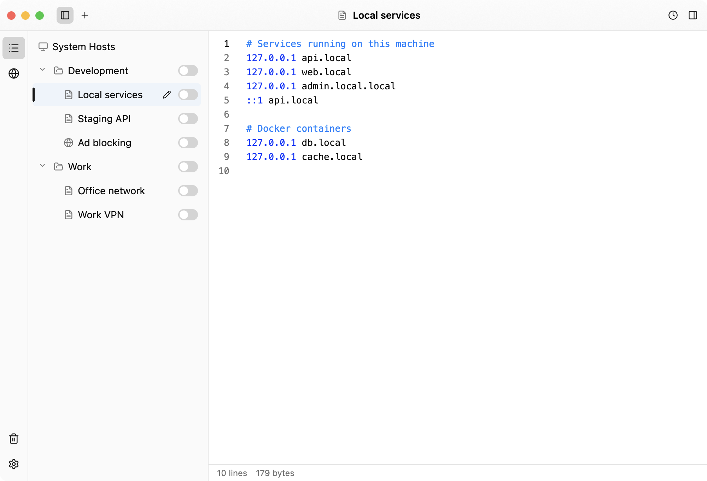

# SwitchHosts Lite

SwitchHosts Lite is a lightweight native hosts switcher for macOS and Windows, written in Rust with GPUI Kit. It keeps the familiar SwitchHosts workflow of organizing hosts rules into entries and switching them on or off, while adding remote subscriptions and isolated browser profiles. The app ships as a single executable with no Electron or WebView layer.

## Entries

Rules can be organized as local entries, remote subscriptions, folders or groups. Local entries are edited in place with syntax highlighting. Remote entries fetch hosts content from an HTTP or HTTPS URL manually or on a schedule. Folders can be nested and use single, multiple or inherited choice modes. Groups combine several entries in a chosen order, and entries can be reordered or regrouped by dragging.

## Automatic hosts management

Turning an entry on or off writes the system hosts file immediately. Editing a local entry also applies changes automatically after a short pause, and failed writes restore the previous switch state. macOS requests an administrator password when needed and caches authorization for the current app run; Windows uses UAC when the hosts file requires elevation.

The app only maintains its own marked block at the end of the hosts file, leaving all other content untouched. A read-only system hosts view is refreshed when the window regains focus if another program has changed the file.

## Browser profiles

Browser profiles apply hosts rules only to a launched Chrome or Edge process, without modifying the system hosts file or requiring administrator access. Each profile has independent switches and can launch a dedicated profile, a temporary incognito session or the everyday browser profile. Profiles support custom names, colors and icons, and their identity can sync between the app and the browser.

## Tray and startup

Closing the window hides SwitchHosts Lite to the menu bar or notification area instead of quitting. A single-instance guard wakes the existing window when the app is launched again. Optional launch-at-login registration can start the app directly in the tray.

## History, trash and backups

System hosts writes and browser profile changes are recorded in a reversible history. Deleted entries and browser profiles go to a trashcan first and can be restored. SwitchHosts v3, v4 and v5 backups can be imported, and data can be exported in the v4 format; browser profiles are included in the app's own backups.

## Editing and appearance

The editor includes shortcuts for commenting, moving, duplicating and deleting lines. The interface follows the system light or dark appearance, includes 36 bundled color themes plus custom theme files, and is available in English, Simplified Chinese and Traditional Chinese. Updates are checked on GitHub Releases and verified before installation.

The project is open source at https://github.com/jarven97/SwitchHostsLite.
