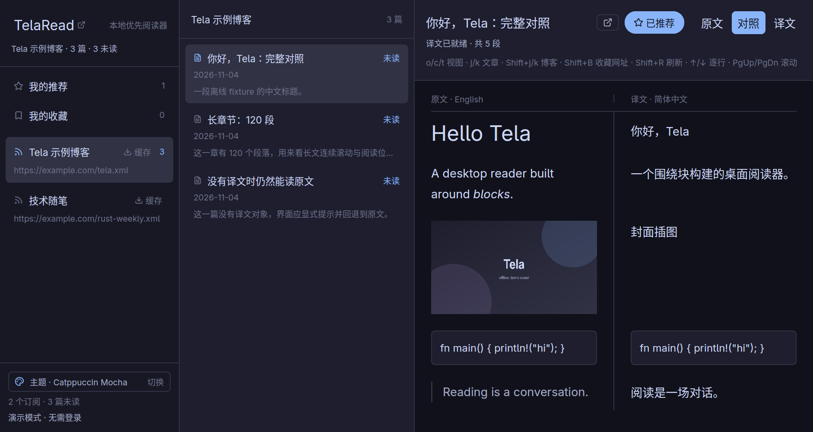
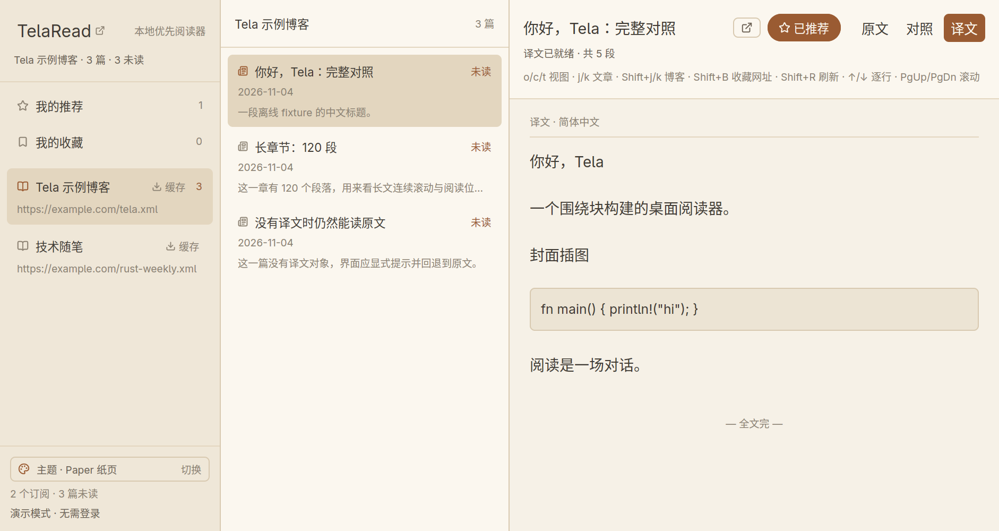
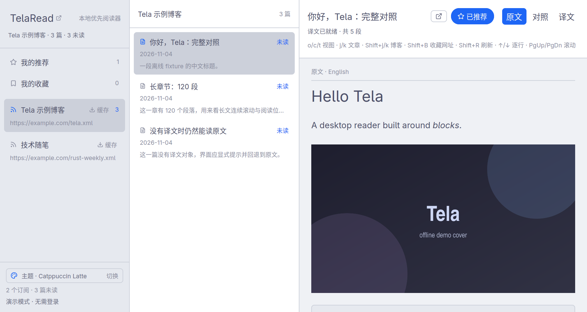

# Tela Desktop

Tela Desktop is a local-first desktop reader for Tela, a community of independent blogs. It is written in Rust with GPUI Kit and keeps subscriptions, articles, translations and images in a local database, so reading continues offline.

## Read in two languages

Switch any article between the original, the translation, and a side-by-side comparison with a single key. Articles without a translation fall back to the original, and a long article scrolls continuously.

## Keep what matters

Cache a whole subscription for offline reading, recommend articles, and bookmark any web page. Bookmarks are extracted to Markdown and checked for updates when opened. Changes made offline are queued and sent at the next sync.

## Make it yours

Choose Catppuccin Mocha, Catppuccin Latte or Paper, or write your own theme file with its own icons, fonts, colors and borders. The app is designed for the keyboard, with shortcuts for moving between articles and blogs, changing views and scrolling.

