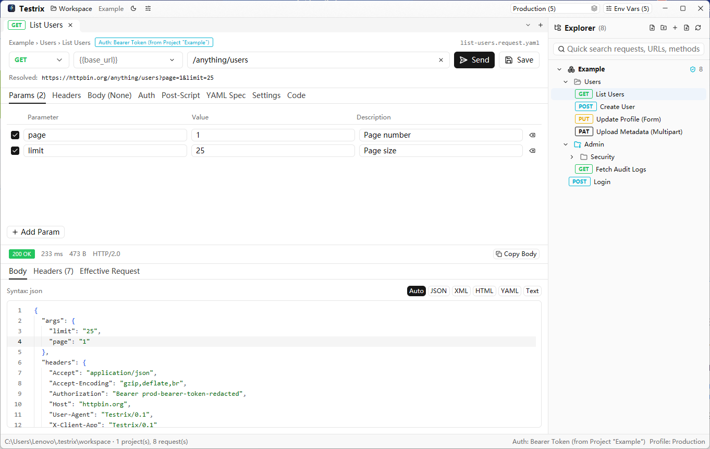

# Testrix

Testrix is a native desktop API client and YAML-backed request workbench built with Rust and GPUI Kit.

## Purpose

Testrix stores every project, folder, HTTP request, and environment profile as human-readable YAML files on disk (`testrix.io/v1`), making API collections easy to version, review, and share alongside application code.

## Key Features

- **Tabbed Request & Response Workbench**: Edit `GET`, `POST`, `PUT`, `DELETE`, `PATCH`, `HEAD`, and `OPTIONS` requests with toggleable query/path parameters, headers, and body modes (JSON, Raw, Form URL-Encoded, Multipart, Binary), alongside syntax-highlighted response inspection.
- **Environments & Variable Interpolation**: Switch between profiles (`Development`, `Staging`, `Production`) and manage `{{variable}}` placeholders, secret variables, and cross-profile variable merging.
- **Cascading Auth Inheritance**: Configure Bearer Token, Basic Auth, API Key, or inheritance at Project, Folder, or Request level with live inheritance inspection.
- **Built-In Git History & Bidirectional Sync**: Automatically track workspace changes as Git commits, restore any request to a previous commit from its history button, and perform 3-way Git merge sync with a self-hosted `node-web` server.
- **Import & Code Generation**: Import OpenAPI 3.0 specs, Postman collections, and Apifox exports, or generate ready-to-run snippets for cURL, Wget, and PowerShell.
- **QuickJS Post-Scripts & Response Meta Info**: Run JavaScript post-scripts after responses to extract tokens into environment variables, save named response examples, and inspect extracted response field schemas.
- **API Documentation Sharing**: Publish read-only API documentation over Local Network, a self-hosted Node/Express server, or Cloudflare Pages + R2.
- **13-Language UI**: Full localization across English, Chinese, Japanese, Korean, French, German, Spanish, Italian, Portuguese, Russian, Arabic, and Turkish.

Learn more on [GitHub](https://github.com/antipro/Testrix).
