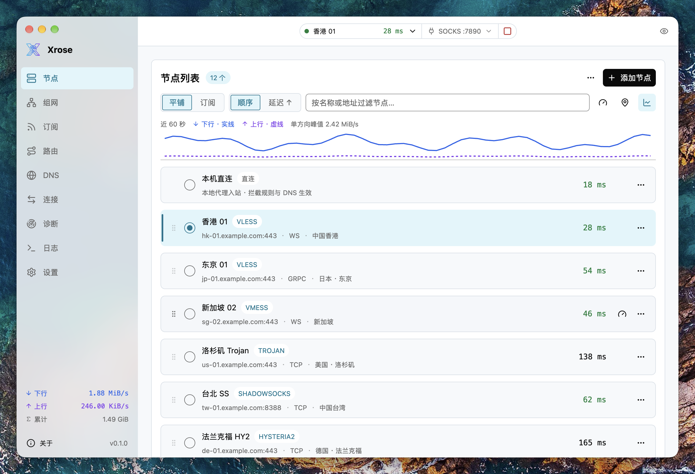
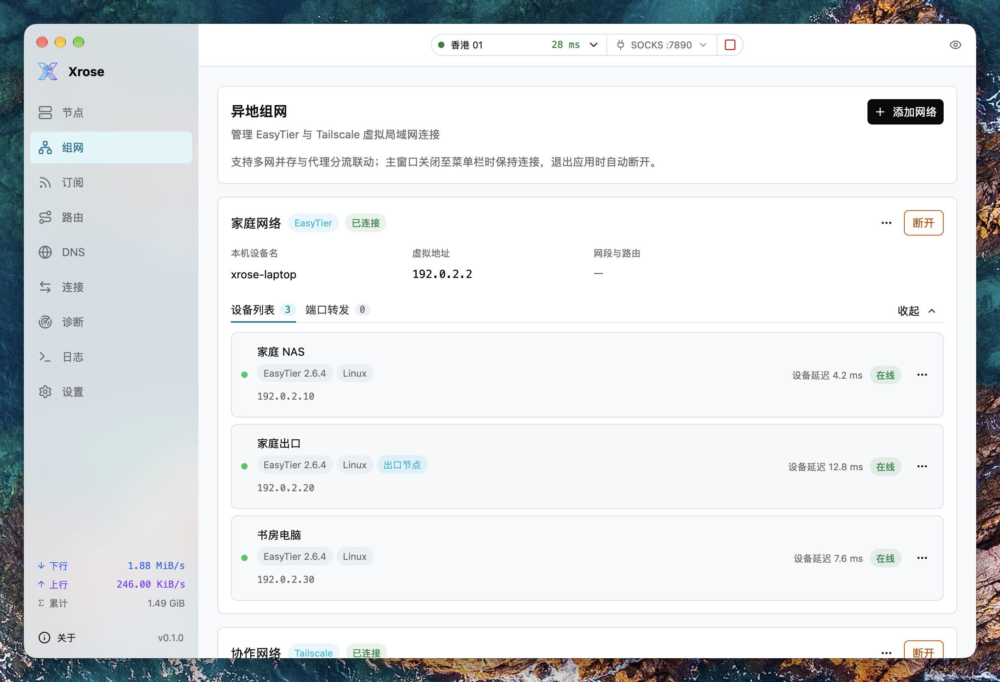
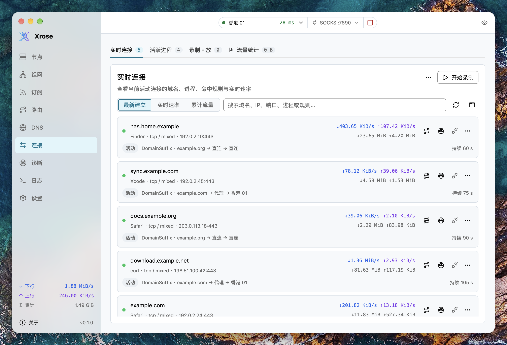
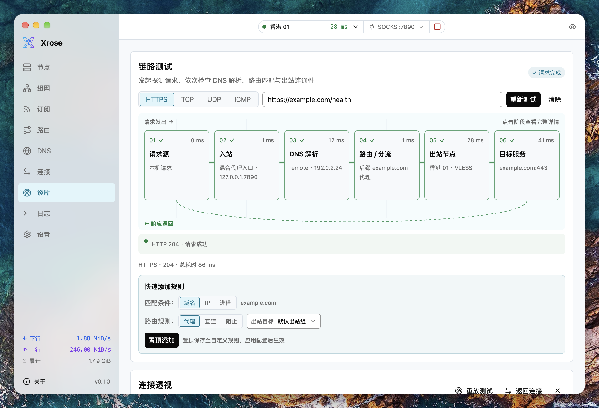
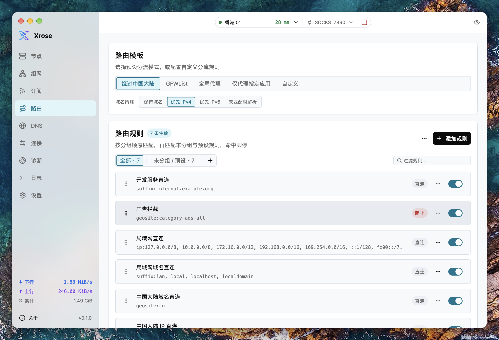

# Xrose

Xrose is a cross-platform desktop client for **sing-box** and **Xray** with integrated **EasyTier** and **Tailscale** mesh networking, written in Rust with GPUI Kit for macOS, Windows, and Linux.

## Native interface and workflows

Xrose adapts to system light and dark themes and renders native window materials across platforms: macOS vibrancy, Windows Mica, Mica Alt, and Acrylic, and Linux Wayland blur with automatic solid-color fallback where blur is unsupported. The interface supports both Chinese and English and synchronizes active work mode, node selection, core state, and live throughput across the main window, top status capsule, and system tray flyout.

Nodes and subscriptions can be imported from clipboard text, share links, Base64 lists, Clash YAML, SIP008, sing-box JSON, dropped files, or cross-screen QR capture. Nodes, routing rules, and custom rule groups support drag-and-drop ordering. A global privacy toggle masks node addresses, domains, and network identifiers across the interface, clipboard exports, and diagnostic reports.

## Three independent work modes

Switching between **Direct**, **Proxy**, and **Mesh** modes preserves all saved nodes, outbound groups, and routing configurations:

- **Direct**: Launches out of the box with the bundled sing-box core and zero required proxy nodes, keeping block rules, ad-blocking rulesets, encrypted DNS, Hosts, and mesh coexistence routes active while skipping proxy-dependent upstreams.
- **Proxy**: Compiles a single core-agnostic configuration model into sing-box or Xray configs with pre-apply core validation and hot reload, covering VMess, VLESS, Trojan, AnyTLS, Shadowsocks, Hysteria2, TUIC, SOCKS, HTTP, WireGuard, OpenVPN, and OpenConnect across system proxy, PAC, TUN, and LAN inbound modes.
- **Mesh**: Takes over system traffic over TUN via a selected EasyTier or Tailscale exit node with per-exit or custom DNS, pausing local proxy rules without overwriting them.

## Integrated EasyTier and Tailscale mesh

EasyTier and a standalone sing-box-backed Tailscale runtime operate concurrently and independently of the main proxy core. Users can advertise or connect through exit nodes and subnet routes, bring mesh exits into proxy outbound groups as routing targets, manage live bidirectional TCP and UDP port forwarding rules without reconnecting, probe member reachability, and share nodes, subscriptions, mesh profiles, or custom rules peer-to-peer with one-time share codes and selective merge previews. Privileged TUN and mesh setup is isolated in a background helper process.

## Traffic monitoring, routing, and diagnostics

The Connections view inspects live connections and per-process traffic aggregation with one-click disconnect or block-rule creation alongside historical usage charts.

The Diagnostics view provides a six-stage link trace covering request origin, inbound, DNS resolution, rule matching, outbound selection, and target response, paired with multi-upstream DNS comparisons, UDP and NAT probing, and sanitized diagnostic report exports.

Routing supports preset templates, custom rule groups, multi-source ruleset updates, SwitchyOmega and AutoProxy rule conversion, outbound group policies (manual, failover, lowest latency, highest throughput, and load balance), and unified HTTP latency testing across direct, proxy, and mesh exits. Node credentials, subscription tokens, and traffic history are encrypted at rest, and a headless companion utility mirrors core workflows for automation.

Xrose is open-source software licensed under GPL-3.0-or-later.

[GitHub repository](https://github.com/zuoxinyu/xrose)
